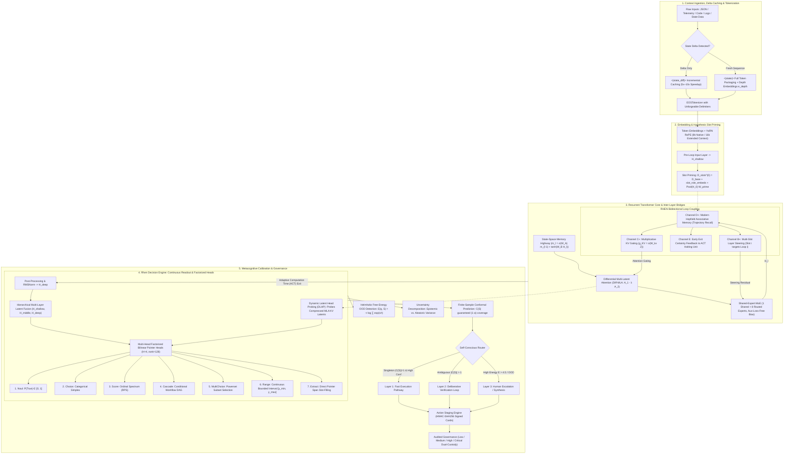

# 🌌 EOS & Rhen ("The Brain"): Exhaustive Theoretical, Mathematical, and System Architecture Specification

> **EOS** represents a paradigm shift away from traditional autoregressive text generation toward **continuous latent space decision architectures**. By unifying parameter-shared recurrent transformer depth, Differential Multi-Latent Attention (Diff-MLA), Shared-Expert Fine-Grained Sparse Mixture-of-Experts (SE-MoE), State-Space Memory Highways (SSM Bridge), and the **Rhen Latent Decision Engine ("The Brain")**, EOS ingests complex multi-modal context states up to 16,000 tokens and evaluates $M$ concurrent structured queries non-autoregressively with $O(1)$ token generation overhead.

---

## 🏛️ Comprehensive System Architecture Topology

---

## 🔬 Deep Mathematical & Theoretical Foundations

### 1. Differential Multi-Latent Attention (Diff-MLA)
When processing extensive enterprise state payloads (e.g., thousands of lines of logs, nested configurations, or telemetry), standard multi-head attention mechanisms suffer from common-mode background noise accumulation. Diff-MLA solves this by projecting queries and keys into dual subspaces and computing a differential attention score:

$$A_1 = \text{Softmax}\left(\frac{Q_1 K_1^T}{\sqrt{d_k}}\right), \quad A_2 = \text{Softmax}\left(\frac{Q_2 K_2^T}{\sqrt{d_k}}\right)$$

$$\text{DiffAttn}(X) = (A_1 - \lambda \odot A_2) V$$

$$\lambda = \exp(\lambda_{q_1} \cdot \lambda_{k_1}) - \exp(\lambda_{q_2} \cdot \lambda_{k_2}) + \lambda_{\text{init}}$$

By dynamically subtracting the secondary attention map $A_2$ (which captures syntax, boilerplate formatting, and structural overhead), the model isolates core relational semantics and suppresses background distractions.

### 2. Fine-Grained Shared-Expert Mixture-of-Experts (SE-MoE)
To expand model capacity while maintaining high inference speed, EOS utilizes a Shared-Expert MoE architecture. Each token representation $x$ is processed through a universal shared expert and a sparse subset of specialized routed experts:

$$\text{MoE}(x) = \text{Expert}_{\text{shared}}(x) + \sum_{i \in \text{Top-}K} g_i(x) \cdot \text{Expert}_i(x)$$

Where the gating weights $g_i(x)$ are computed via a softmax distribution over expert affinity scores. To prevent expert collapse without sacrificing training stability, EOS integrates **auxiliary-loss-free dynamic load balancing**, adjusting routing bias terms directly based on historical dispatch frequencies.

### 3. Continuous-Time State-Space Memory Highway (SSM Bridge)
To maintain gradient flow and long-range coherence across deep recurrent loop unrolls, a discretized continuous-time state-space highway runs parallel to the transformer blocks:

$$h_t = \bar{A} h_{t-1} + \bar{B} x_t, \quad y_t = C h_t + D x_t$$

$$\bar{A} = \exp(-\Delta \cdot \text{Softplus}(A_{\log})), \quad \bar{B} = \Delta \cdot B$$

This bridge functions as a continuous memory backbone, allowing information to persist across recurrent passes without suffering from exponential gradient decay.

---

## 🎯 The 7 Typed Continuous Latent Decision Primitives

The Rhen Latent Decision Engine evaluates structured queries by projecting continuous latent states into seven specialized decision primitives:

1. **Noul (Binary Truth Value):** Evaluates logical propositions against context states, producing a calibrated probability $P(\text{True}) \in [0, 1]$.
2. **Choice (Categorical Simplex):** Selects 1-of-$K$ discrete operational paths, yielding a strictly normalized probability distribution over a valid simplex ($\sum p_i = 1.0$).
3. **Score (Ordinal Spectrum):** Maps metrics onto ordered rating scales, optimized via Ranked Probability Score (RPS) loss to penalize distance proportional to category separation.
4. **Cascade (Conditional Workflow DAG):** Evaluates multi-step dependency graphs where execution branches trigger dynamically based on child node outcomes.
5. **MultiChoice (Powerset Selection):** Determines subset inclusion over multi-label spaces via independent sigmoid probability thresholds and dynamic entropy bounds.
6. **Range (Bounded Continuous Regression):** Predicts continuous numerical intervals $[y_{\min}, y_{\max}]$ parametrized using Beta distribution shape parameters $(\alpha, \beta)$ to model rigorous confidence bounds.
7. **Extract (Span Pointer Extraction):** Locates exact character or token span boundaries directly within the input buffer using dual multi-head bilinear start and end pointer heads.

---

## 🛡️ Metacognitive Calibration & Governance Architecture

### Finite-Sample Conformal Prediction Sets
EOS guarantees statistical reliability by constructing finite-sample conformal prediction sets $\mathcal{C}(S)$ over model outputs. For a target error rate $\alpha \in (0, 1)$:

$$P(Y_{\text{true}} \in \mathcal{C}(S)) \ge 1 - \alpha$$

If the prediction set contains a single candidate ($\vert \mathcal{C}(S) \vert = 1$), the decision is executed immediately through Layer 1 (Fast Pathway). If the set contains multiple options ($\vert \mathcal{C}(S) \vert > 1$), the engine routes the input to Layer 2 for counterfactual verification unrolls.

### Out-of-Distribution (OOD) Helmholtz Free-Energy Detection
To detect unanswerable, corrupted, or adversarial inputs, the system computes the Helmholtz Free Energy $E(q, S)$ over query-state latent representations:

$$E(q, S) = -\tau \cdot \log \sum_{i} \exp\left(\frac{s_i}{\tau}\right)$$

When $E(q, S)$ exceeds predefined anomaly thresholds ($E > 4.5$), the system flags the state as Out-of-Distribution, abstaining from automated execution and routing the query to Layer 3 for synthesis or human review.

### Cryptographic Action Cards & Dual-Custody Verification
Validated outputs are packaged into immutable, digitally signed **Action Cards**:
* **Cryptographic Signature:** Every card is hashed and signed using HMAC-SHA256 containing state metadata, decision bounds, and timestamp verification.
* **Execution Tiers:** Actions are classified by risk (Low, Medium, High, Critical). High and Critical tiers require dual-custody approval signatures before execution.

---

## 🔒 License

Released under the [MIT License](LICENSE).