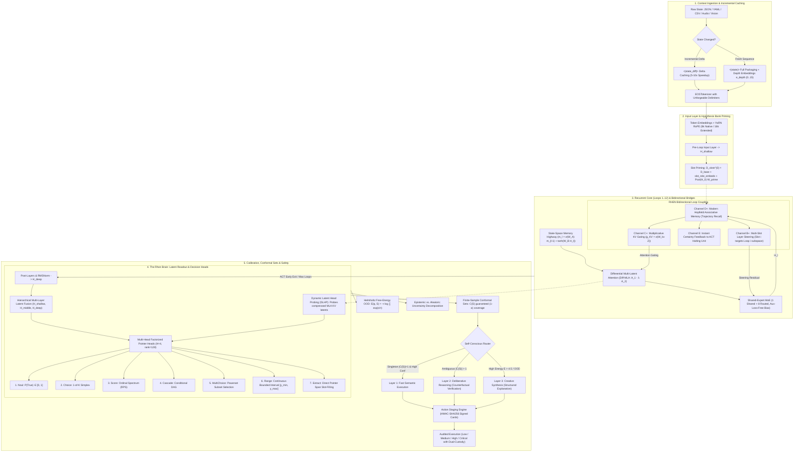

# 🌌 EOS & Rhen ("The Brain"): Comprehensive Theoretical, Mathematical, and Architectural Foundation

> **EOS** represents a fundamental paradigm shift away from traditional autoregressive token generation toward **System One continuous latent reasoning**. By uniting parameter-shared recurrent depth, Differential Multi-Latent Attention (Diff-MLA), Shared-Expert Fine-Grained Sparse Mixture-of-Experts (SE-MoE), State-Space Memory Highways (SSM Bridge), and the **Rhen Latent Decision Engine ("The Brain")**, EOS evaluates $M$ complex questions simultaneously over a single state prefix in $O(1)$ token generation overhead with rigorous finite-sample conformal guarantees, out-of-distribution anomaly detection, and cryptographic action execution.

---

## 🏛️ Comprehensive Architectural Blueprint & Dataflow

---

## 🌐 Executive Summary: The Death of Autoregressive Overhead

Traditional Large Language Models (LLMs) are fundamentally bottlenecked by autoregressive text generation: answering questions, executing operational logic, or verifying system states requires outputting tokens sequentially ($O(N)$ token generation cost). This introduces immense latency, high compute overhead, and severe vulnerability to compounding error drift during complex inference chains.

EOS & Rhen ("The Brain") completely upends this paradigm. By decoupling **state ingestion** from **latent semantic decision-making**, EOS ingests complex contexts up to 16,000 tokens using YaRN RoPE scaling and passes them through a parameter-shared recurrent core. Rather than generating text paragraphs, the Rhen engine probes compressed multi-layer latent vectors using factorized pointer heads. This achieves absolute $O(1)$ token generation overhead for complex decision payloads, executing rigorous logical judgments, interval regressions, and multi-class selections instantaneously in continuous latent space.

---

## 🔬 Core Architectural Subsystems & Mathematical Formulations

### 1. Differential Multi-Latent Attention (Diff-MLA)
Standard transformer attention mechanisms suffer from severe common-mode background noise accumulation when processing long, highly structured states (such as dense JSON trees, multi-file logs, or continuous telemetry streams). Diff-MLA eliminates this by maintaining dual attention subspaces and computing a dynamic difference score:
$$A_1 = \text{Softmax}\left(\frac{Q_1 K_1^T}{\sqrt{d_k}}\right), \quad A_2 = \text{Softmax}\left(\frac{Q_2 K_2^T}{\sqrt{d_k}}\right)$$
$$\text{DiffAttn}(X) = (A_1 - \lambda \odot A_2) V$$
$$\lambda = \exp(\lambda_{q_1} \cdot \lambda_{k_1}) - \exp(\lambda_{q_2} \cdot \lambda_{k_2}) + \lambda_{\text{init}}$$
This mechanism automatically subtracts syntactic background noise, formatting overhead, and redundant prompt framing, directing the network's effective representational bandwidth entirely toward high-signal structural data.

### 2. Shared-Expert Mixture-of-Experts (SE-MoE)
To decouple model expressivity from active computational cost, EOS implements a sparse Mixture-of-Experts architecture featuring 1 universal shared expert and 8 routed domain experts (with Top-2 sparse activation per token):
$$\text{MoE}(x) = \text{Expert}_{\text{shared}}(x) + \sum_{i \in \text{Top-}K} g_i(x) \cdot \text{Expert}_i(x)$$
Load balancing is maintained via auxiliary-loss-free dynamic bias adaptation, avoiding the collapse of expert routing without harming training convergence stability.

### 3. State-Space Memory Highway (SSM Bridge)
Recurrent neural architectures frequently struggle with vanishing gradients across deep unrolled reasoning loops. The SSM Bridge embeds a discretized linear state-space memory backbone alongside the transformer blocks:
$$h_t = \bar{A} h_{t-1} + \bar{B} x_t, \quad y_t = C h_t + D x_t$$
$$\bar{A} = \exp(-\Delta \cdot \text{Softplus}(A_{\log})), \quad \bar{B} = \Delta \cdot B$$
This creates a continuous-time recurrent highway that preserves long-range state dynamics across recursive reasoning loops without signal decay.

---

## 🎯 The 7 Non-Autoregressive Decision Primitives

Rhen avoids generative text formatting by directly evaluating typed semantic primitives over continuous latent spaces:

1. **Noul (Binary Semantic Truth):** Evaluates logical propositions against the ingested context state, outputting a strictly calibrated probability $P(\text{True}) \in [0, 1]$.
2. **Choice (Categorical Simplex):** Computes categorical selection across $K$ discrete operational branches, mapping outputs onto a proper probability simplex ($\sum p_k = 1.0$).
3. **Score (Ordinal Spectrum):** Positions decisions along an ordered severity or priority spectrum, evaluated via Ranked Probability Scores (RPS) to penalize magnitude errors.
4. **Cascade (Conditional DAG):** Evaluates multi-stage conditional workflows where subsequent decision branches depend dynamically on the latent outcome of preceding nodes.
5. **MultiChoice (Powerset Subset Selection):** Evaluates independent sigmoid selection thresholds to identify multiple concurrent valid subset flags from large categorical catalogs.
6. **Range (Interval Regression):** Predicts continuous scalar bounds $[y_{\min}, y_{\max}]$ parametrized via Beta distribution shape parameters $(\alpha, \beta)$, guaranteeing precise confidence intervals.
7. **Extract (Span Pointer):** Extracts exact character spans (such as error hashes, database IDs, or IP addresses) directly from the context buffer using dual bilinear start/end pointer heads.

---

## 📐 Advanced Structural Protocols

### 1. 2D Block-Causal Branch Masking Protocol
To process parallel inquiry questions without cross-talk contamination, EOS employs a 2D block-causal attention mask. Tokens within the state context attend fully to one another, while distinct decision query branches are isolated into orthogonal blocks that can read the state context bidirectionally but cannot pollute each other's hidden representations.

### 2. Multi-Head Bilinear Pointer Heads
Extraction and span selection primitives utilize factorized bilinear pointer heads ($H=4$ heads, rank=128 projection dimension). Rather than scoring vocabulary logits, these heads compute inner-product attention matrices between context token representations and query slot embeddings, locating precise start and end span boundaries with sub-token precision.

### 3. Recurrent Core Slot Orthogonality & Trajectory Memory
Across recurrent loop passes ($l = 1 \dots 12$), hypotheses are maintained in dedicated memory slots. To prevent representation collapse, slot orthogonality is enforced via regularization. Furthermore, Modern Hopfield Associative Memory bridges store and recall historical loop trajectories (Channel D+), allowing the model to inspect its own iterative convergence path.

---

## 🛡️ Three-Layer Decision Pipeline & Metacognitive Calibration

EOS routes every decision through a self-conscious three-layer execution pipeline governed by finite-sample conformal prediction and Helmholtz free-energy anomaly detection:

* **Layer 1 (Fast Semantic Execution):** Triggered when conformal prediction sets yield a singleton set ($\mathcal{C}(S) = 1$) with high epistemic confidence and low free-energy ($E < 4.5$). Decisions execute instantly in $O(1)$ time.
* **Layer 2 (Deliberative Reasoning):** Triggered when conformal sets indicate ambiguity ($\vert \mathcal{C}(S) \vert > 1$). The model runs counterfactual verification loops across additional recurrent passes to resolve ambiguity.
* **Layer 3 (Creative Synthesis):** Triggered when Helmholtz free-energy anomaly detection flags out-of-distribution (OOD) states ($E \ge 4.5$). The model falls back to structured explanatory generation or human escalation.

---

## 🔐 Cryptographic Action Cards & Governance

High-consequence operational decisions made by the Rhen engine are not executed blindly. The action staging engine wraps approved outputs into **Cryptographic Action Cards**:
* **Payload Verification:** Encapsulates target service parameters, confidence bounds, and conformal guarantees.
* **HMAC-SHA256 Signing:** Digitally signs every card to prevent man-in-the-middle manipulation.
* **Dual-Custody Enforcement:** Automatically routes actions through low, medium, high, or critical execution tiers, enforcing dual-custody approval gates for critical infrastructure commands.

---

## 🧩 Cognitive Extensions & Training Paradigms

* **Direct Preference Policy Optimization (DDPO):** Aligns latent decision heads directly with human operational preferences without requiring intermediate text generation rewards.
* **Reinforcement Learning from Conformal Decisions (RLCD):** Optimizes decision policies based on conformal coverage bounds rather than raw cross-entropy loss.
* **Threshold Duration Training (TDT):** Dynamically adjusts Adaptive Computation Time (ACT) halting thresholds based on decision difficulty.
* **Multilingual Routing & Evidence Lattices:** Supports cross-lingual state ingestion and maintains structured evidence lattices for multi-step verifiable audits.

---

## 🔒 License

EOS and the Rhen Decision Engine are released under the [MIT License](LICENSE).