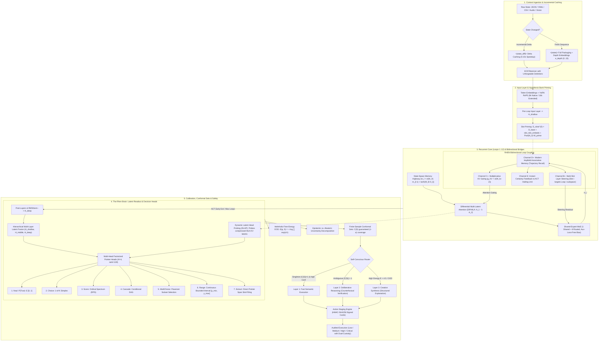

# 🌌 EOS & Rhen ("The Brain"): Architectural Blueprint & Advanced Foundations

> **EOS** is an open-source neural cognitive architecture combining **parameter-shared recurrent depth**, **Shared-Expert Fine-Grained Sparse Mixture-of-Experts (SE-MoE)**, **Differential Multi-Latent Attention (Diff-MLA)**, **Multi-Token Prediction (MTP)**, **State-Space Memory Highway (SSM Bridge)**, and the **Rhen Latent Decision Engine ("The Brain")** — a non-autoregressive "System One" decision engine.

---

## 🏛️ Comprehensive Architectural Blueprint

---

## 🚀 Architectural Foundations & Innovations

### 1. Differential Multi-Latent Attention (Diff-MLA)
Cancels common-mode background noise and sharpens signal-to-noise ratio over dense state prefixes:
$$A_1 = \text{Softmax}\left(\frac{Q_1 K_1^T}{\sqrt{d_k}}\right), \quad A_2 = \text{Softmax}\left(\frac{Q_2 K_2^T}{\sqrt{d_k}}\right)$$
$$\text{DiffAttn}(X) = (A_1 - \lambda \odot A_2) V$$
$$\lambda = \exp(\lambda_{q_1} \cdot \lambda_{k_1}) - \exp(\lambda_{q_2} \cdot \lambda_{k_2}) + \lambda_{\text{init}}$$

### 2. Shared-Expert Mixture-of-Experts (SE-MoE)
Hybrid expert architecture combining $N_{\text{shared}} = 1$ dedicated universal expert with Top-$K$ routed specialist experts ($N_{\text{routed}} = 8, K = 2$):
$$\text{MoE}(x) = \text{Expert}_{\text{shared}}(x) + \sum_{i \in \text{Top-}K} g_i(x) \cdot \text{Expert}_i(x)$$
- Uses **auxiliary-loss-free dynamic load balancing** via learnable expert routing biases updated per batch.

### 3. State-Space Memory Highway (SSM Bridge)
Discretized continuous-time recurrent highway bridging sequential recurrent loop passes:
$$h_t = \bar{A} h_{t-1} + \bar{B} x_t, \quad y_t = C h_t + D x_t$$
$$\bar{A} = \exp(-\Delta \cdot \text{Softplus}(A_{\log})), \quad \bar{B} = \Delta \cdot B$$
- Bridges multi-loop representations and preserves long-range state dependencies without gradient vanishing.

---

## 🧠 The 7 Rhen Decision Primitives

1. **Noul (Binary Semantic Truth)**: Evaluates proposition truth with $P \in [0, 1]$.
2. **Choice (Categorical Selection)**: Selects 1 winner from $K$ candidates with strictly proper probabilities.
3. **Score (Ordered Spectrum)**: Computes expected level value over discrete ordered options using Ranked Probability Score (RPS) calibration.
4. **Cascade (Chained DAGs)**: Sequential DAG execution with counterfactual verification.
5. **MultiChoice (Subset Selection)**: Evaluates independent sigmoid selection thresholds predicted from query entropy.
6. **Range (Interval Regression)**: Continuous scalar estimation via Beta distribution shape parameters $(\alpha, \beta)$ with 95% confidence bounds.
7. **Extract (Span Pointer)**: Extracts token spans directly from state prefix representation using dual start/end pointers.

---

## 📂 Repository Structural Layout

- `config.py` — Models system hyperparameters via `EOSConfig`.
- `model.py` — Implements `EOSModel` (Recurrent Transformer, Diff-MLA, SE-MoE, SSM Bridge).
- `rhen.py` — Contains `AdvancedRhenEngine`, factorized multi-head pointer logic, and core decision primitives.
- `rhen_chunker.py` — State chunking and semantic boundary management for long context states.
- `rhen_cognition.py` — Integrates RLCD policy optimization, TDT duration thresholding, and multilingual routing.
- `rhen_pillars.py` — Handles out-of-band audit logging, geometry-based abstention, and credit assignment.
- `unified_orchestrator.py` — Bridges context building, decision routing, and cryptographic Action Card staging.

---

## 🔒 License

Released under the [MIT License](LICENSE).