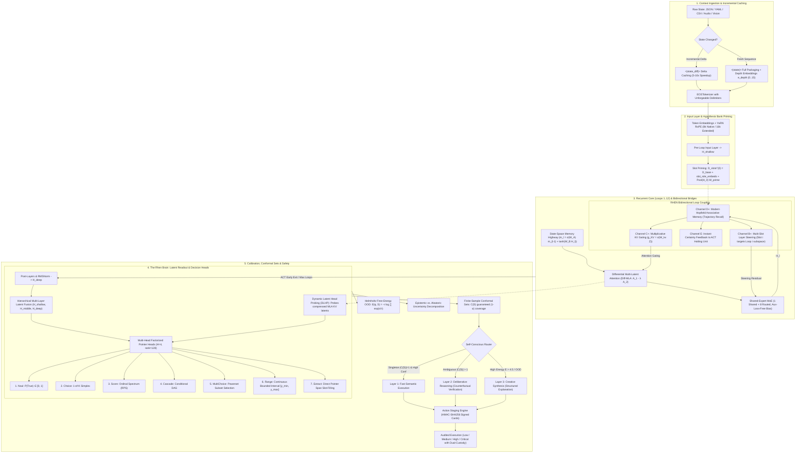

# 🌌 EOS & Rhen ("The Brain") Decision Engine

[](https://pytorch.org/)
[]()
[]()
[]()
[-brightgreen.svg)]()
[]()
[](Architecture.md)
[](LICENSE)

> **EOS** is an open-source neural cognitive architecture combining **parameter-shared recurrent depth**, **Shared-Expert Fine-Grained Sparse Mixture-of-Experts (SE-MoE)**, **Differential Multi-Latent Attention (Diff-MLA)**, **Multi-Token Prediction (MTP)**, **State-Space Memory Highway (SSM Bridge)**, and the **Rhen Latent Decision Engine ("The Brain")** — a non-autoregressive "System One" decision engine.
>
> ⚡ **Full architecture, benchmarks, and roadmap**: see [Architecture.md](Architecture.md) for full deep-dive mathematical blueprints.
>
> 🧠 **Decision Engine Capabilities**: Evaluates $M$ concurrent questions over a single state prefix in $O(1)$ state compute with zero generation token overhead, finite-sample conformal prediction guarantees, cryptographic HMAC-SHA256 Action Cards, and dual-custody consensus execution.

> **Naming:** EOS was previously published under legacy names like `EOSLoopedLLM` and `LoopedLLMConfig`. The canonical symbols are now `EOSModel` and `EOSConfig` (`model_type = "eos"`), with legacy aliases preserved for backward compatibility.

---

## 🏛️ Comprehensive Architectural Blueprint



---

## 🎯 The 7 Typed Semantic Decision Primitives

Rhen exposes seven typed semantic decision primitives evaluated non-autoregressively in continuous latent space without text generation overhead:

1. **Noul (Binary Semantic Truth)**: Evaluates proposition truth returning $P(\text{True}) \in [0, 1]$ and confidence metric $c = |2p - 1|$.
2. **Choice (Categorical Selection)**: Selects winning option from $K$ candidates with strictly proper normalized probabilities ($\sum p_k = 1.0$).
3. **Score (Ordered Spectrum)**: Positions state along discrete scale levels mapped to continuous expected value via Ranked Probability Score (RPS).
4. **Cascade (Chained DAGs)**: Sequential multi-stage conditional decision pipelines.
5. **MultiChoice (Subset Selection)**: Evaluates independent sigmoid candidate probabilities with query-adaptive entropy thresholds.
6. **Range (Continuous Interval)**: Estimates scalar values on $[y_{\min}, y_{\max}]$ using predicted Beta distribution parameters $(\alpha, \beta)$ with 95% confidence bounds.
7. **Extract (Span Pointer)**: Extracts text values (IPs, UUIDs, hostnames) directly from state text via dual start/end bilinear pointers.

---

## ⚡ Inter-Layer Communication Bridges

1. **Input Layer $\leftrightarrow$ RHEN (Delta Caching & Depth Embeddings)**: `<|state_diff|>` token provides $5-10\times$ token speedup on continuous state updates. Learned depth embeddings map structural indentation ($0 \dots 15$).
2. **Recurrent Core $\leftrightarrow$ RHEN (Channel B+ & Channel D+)**: Multi-slot layer steering targets loop-specific subspaces, while Modern Hopfield associative memory stores trajectory states to prevent recurrent drift.
3. **RHEN $\leftrightarrow$ Output Layer (Dual-Path Conditioning)**: Non-autoregressive decision latents directly cross-condition downstream token generation heads, locking text explanations to latent decision outputs.

---

## 🚀 Quick Start & Usage

```python
from config import EOSConfig
from model import EOSModel
from rhen import Choice, Noul, MultiChoice, Range, Extract
from unified_orchestrator import UnifiedAIOrchestrator

# 1. Initialize config and model
config = EOSConfig(
    hidden_size=256,
    intermediate_size=512,
    num_hidden_layers=2,
    max_recurrent_loops=3,
    use_diff_mla=True,
    use_aux_free_balancing=True,
)
model = EOSModel(config)
orchestrator = UnifiedAIOrchestrator(config)

# 2. Build structured context
ctx = orchestrator.create_context_builder()
ctx.add_entity("Cluster", "prod-us-east-1", {"nodes": 48, "status": "degraded"})
ctx.add_json({"p99_latency_ms": 840, "error_rate": 0.048})

# 3. Execute decisions with conformal sets and cryptographic action cards
result = orchestrator.unified_decide_sync(
    state=ctx,
    questions=[
        Choice("Primary action", ["Scale Pods", "Throttle API", "Failover Region"]),
        Range("Estimated recovery time", min_val=0.0, max_val=120.0),
        MultiChoice("Active incident flags", ["HighLatency", "RateLimitBreached"]),
        Extract("cluster_id", query="Target cluster identifier"),
    ],
    use_three_layer=True,
    auto_stage_actions=True,
)

# 4. Process calibrated outcomes and HMAC-signed cards
for ans in result["final_answers"]:
    print(f"Decision: {ans.get('outcome')} (Confidence: {ans.get('confidence'):.2%})")

for card in result["staged_actions"]:
    print(card.to_markdown())
```

---

## 🧪 Master Test Runner

Execute the automated test runner across all 14 test suites and architectural gates:

```bash
python run_tests.py              # Run complete test suite (14 test suites)
python run_tests.py --fast       # Fast-path verification loop (<15s)
python run_tests.py --slow       # Execute heavy architectural gates
python run_tests.py --list       # Display test matrix and suite classifications
```

---

## 📄 License

EOS & the Rhen Decision Engine are released under the [MIT License](LICENSE).