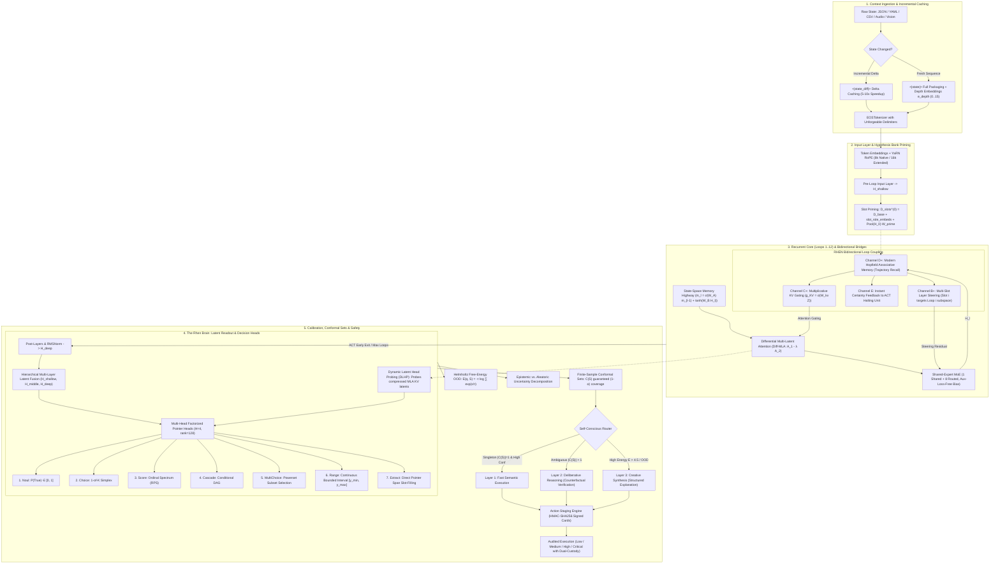

# 🌌 EOS & Rhen ("The Brain") Decision Engine

[-brightgreen.svg)]()

> **EOS** is an open-source neural cognitive architecture combining **parameter-shared recurrent depth**, **Shared-Expert Fine-Grained Sparse Mixture-of-Experts (SE-MoE)**, **Differential Multi-Latent Attention (Diff-MLA)**, **Multi-Token Prediction (MTP)**, **State-Space Memory Highway (SSM Bridge)**, and the **Rhen Latent Decision Engine ("The Brain")** — a non-autoregressive "System One" decision engine.
>
> 🧠 **Core Capabilities:** Evaluates $M$ concurrent questions over a single state prefix in $O(1)$ state compute with zero token generation overhead, finite-sample conformal prediction guarantees, cryptographic HMAC-SHA256 Action Cards, and dual-custody consensus execution.
>
> 📖 **Full Architectural Deep-Dive:** Check out the complete mathematical and theoretical specification in [Architecture.md](Architecture.md).

> **Naming Convention Note:** EOS was originally developed under legacy nomenclature (`EOSLoopedLLM`, `LoopedLLMConfig`). The canonical symbols are now `EOSModel` and `EOSConfig` (`model_type = "eos"`), with legacy aliases fully supported for backward compatibility across all modules.

---

## 🏛️ High-Level System Overview & Conceptual Architecture

---

## 🎯 The 7 Typed Semantic Decision Primitives

Rhen exposes seven typed semantic decision primitives evaluated non-autoregressively in continuous latent space:
1. **Noul:** Evaluates binary proposition truth ($P(\text{True}) \in [0, 1]$)